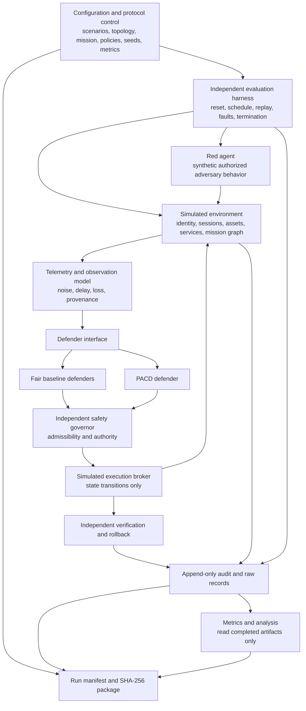

# PACD Local Simulation Environment Architecture

**Document ID:** PACD-SIM-ENV-ARCH-001  
**Version:** 1.0  
**Date:** 2026-08-22  
**Status:** Proposed implementation architecture for environment bootstrap  
**Evidence status:** Author-directed design; implementation and machine validation not yet established

## 1. Architectural objective

The environment must support a transparent, local-first, CPU-only PACD simulator while protecting the host, preserving provenance, and preventing diagnostic code from being mistaken for empirical evidence. It should be reconstructible from a locked repository without requiring a commercial platform, GPU, container runtime, cloud service, or production security integration.

The architecture maps the PACD conceptual layers into an implementable research codebase while keeping the evaluation harness independent from the defender under test.

## 2. Host and trust-boundary architecture

```text
+-----------------------------------------------------------------------+
| Windows host                                                           |
|                                                                       |
|  Protected, read-only user zones                                      |
|  Desktop | Documents | Downloads | OneDrive redirected equivalents    |
|                                                                       |
|  Pre-existing software zone                                           |
|  Existing Python/Git/VS Code/Node/CUDA/Docker/etc. — preserve only    |
|                                                                       |
|  +-----------------------------------------------------------------+  |
|  | PACD bounded workspace                                           |  |
|  | %USERPROFILE%\PACD-Workspaces\PACD-Simulation                   |  |
|  |                                                                 |  |
|  | package/      immutable instruction package                    |  |
|  | repo/         Git working tree and .venv                       |  |
|  | var/          downloads, cache, tmp, local runs                |  |
|  | status/       preflight, logs, decisions, validation           |  |
|  +-----------------------------------------------------------------+  |
|                                                                       |
|  Outbound-only authorized services                                    |
|  official package sources | GitHub | official documentation           |
+-----------------------------------------------------------------------+
```

All work-product paths remain inside the bounded workspace. Installers may use their normal user-scoped application-data location, but no manual work occurs in protected folders or pre-existing application directories.

## 3. Logical simulation architecture



### Architectural invariants

- The evaluation harness controls reset, schedule, fault injection, termination, and artifact export.
- The defender under test cannot alter scenarios, metrics, authorization, seed registries, or harness code during a run.
- All defenders implement the same typed interface.
- Fair-comparison modes explicitly control which observations, actions, mission information, and execution reliability each defender receives.
- The safety governor is independent of the PACD planner and all baselines.
- Execution is a simulated state transition, never a real system API call.
- Verification evaluates observed outcome and rollback independently of the proposing component.
- Audit is append-only at application level and contains accepted and rejected proposals.
- Metrics read completed raw records; they do not mutate run state.
- Every completed run has a manifest tying code, configuration, seed, interpreter, lockfile, and artifacts together.

## 4. Mapping to the PACD eleven-layer architecture

| PACD logical layer | Research implementation module | Primary responsibility |
|---|---|---|
| 1. Telemetry and sensor ingestion | `telemetry/` | Generate and ingest synthetic observations with source, time, coverage, delay, and integrity metadata. |
| 2. Normalization and evidence fabric | `evidence/` | Normalize, correlate, preserve provenance, and avoid premature certainty. |
| 3. Enterprise state and mission model | `state/`, `environment/` | Dynamic graph of identities, sessions, assets, services, dependencies, mission criticality, and governance context. |
| 4. Adversary modeling and threat hypotheses | `hypotheses/`, `agents/red/` | Maintain red behavior and defender-side competing threat hypotheses. |
| 5. Defensive knowledge and action ontology | `actions/`, `schemas/` | Typed actions, preconditions, expected effects, mission costs, reversibility, authority, verification, and rollback. |
| 6. Polymorphism management | `polymorphism/` | Generate and score sensing, deception, infrastructure, identity, response, and coordination variation. |
| 7. Multi-agent orchestration | `orchestration/` | Reconcile specialized proposals, sequence actions, resolve conflict, and preserve role boundaries. |
| 8. Safety, policy, and governance | `governance/` | Hard admissibility, prohibited actions, autonomy tiers, policy versioning, and fail-closed behavior. |
| 9. Human oversight and mission command | `oversight/` | Simulated approval delay, approval/denial/override, decision packages, and accountability. |
| 10. Controlled execution and integration | `execution/` | Simulated execution broker with scoped action targets and no real integrations. |
| 11. Learning, evaluation, and audit | `audit/`, `metrics/`, `analysis/` | Raw records, outcome verification, calibration records, metric generation, and reproducibility evidence. |

The evaluation harness is deliberately outside the eleven-layer system under test so it can control and observe all defender conditions consistently.

## 5. Repository architecture

```text
pacd-simulation/
├─ AGENTS.md
├─ README.md
├─ LICENSE_PENDING.md
├─ pyproject.toml
├─ uv.lock
├─ .python-version
├─ .editorconfig
├─ .gitattributes
├─ .gitignore
├─ configs/
│  ├─ protocol/
│  │  ├─ draft/
│  │  └─ frozen/                 # author approval required
│  ├─ scenarios/
│  ├─ topologies/
│  ├─ missions/
│  ├─ adversaries/
│  ├─ defenders/
│  ├─ policies/
│  ├─ metrics/
│  └─ seeds/
├─ schemas/
├─ src/pacd_sim/
│  ├─ cli.py
│  ├─ harness/
│  ├─ engine/
│  ├─ environment/
│  ├─ telemetry/
│  ├─ evidence/
│  ├─ state/
│  ├─ hypotheses/
│  ├─ actions/
│  ├─ polymorphism/
│  ├─ orchestration/
│  ├─ governance/
│  ├─ oversight/
│  ├─ execution/
│  ├─ audit/
│  ├─ metrics/
│  ├─ analysis/
│  ├─ reproducibility/
│  ├─ agents/red/
│  └─ defenders/
│     ├─ base.py
│     ├─ baselines/
│     └─ pacd/
├─ tests/
│  ├─ unit/
│  ├─ property/
│  ├─ scenario/
│  ├─ negative/
│  └─ reproducibility/
├─ docs/
├─ status/
├─ artifacts/                    # diagnostic outputs; gitignored
└─ var/                          # cache, tmp, downloads, runs; gitignored
```

## 6. Configuration and protocol architecture

Human-authored YAML is accepted only as input. At run start:

1. Pydantic validates every configuration object.
2. The validated object is serialized to canonical JSON with deterministic key ordering and number formatting.
3. SHA-256 is calculated for each component and the aggregate run configuration.
4. The harness copies the canonical configuration into the run directory.
5. The harness checks the same hashes at completion.

Configuration families include:

- topology and entity graph;
- mission functions, dependencies, criticality, tolerances, and recovery priorities;
- telemetry coverage, delay, noise, integrity, and degradation;
- adversary archetype, objective, observation, and adaptation policy;
- defender condition and fair-access profile;
- action ontology and execution reliability;
- safety constraints, authorization tiers, and human approval delay;
- metrics and termination conditions;
- seed registry and replication plan.

### Protocol freeze interlock

`configs/protocol/draft/` is editable under version control. `configs/protocol/frozen/` is controlled. No run may be labeled reportable unless an author-approved `APPROVAL.json` matches:

- protocol version;
- exact Git commit;
- aggregate configuration hash;
- seed-registry hash;
- baseline-definition hash;
- metric-definition hash;
- approval identity and timestamp.

The CLI must fail closed when any field is absent or mismatched. The environment bootstrap does not create this record.

## 7. Typed core objects

The initial schemas should include:

- `Asset`, `Identity`, `Session`, `Credential`, `Service`, `MissionFunction`, `Dependency`;
- `Sensor`, `Observation`, `EvidenceItem`, `DetectorProfile`;
- `ThreatHypothesis`, `AdversaryState`, `BeliefState`;
- `DefensiveAction`, `PolymorphismOperator`, `Constraint`, `PolicyDecision`;
- `ApprovalRecord`, `ExecutionRecord`, `VerificationRecord`, `RollbackRecord`;
- `AuditEvent`, `EpisodeRecord`, `MetricRecord`, `RunManifest`.

Every consequential object should contain stable IDs, timestamps or simulation ticks, source/provenance, configuration version, and schema version.

## 8. Event and data architecture

### Raw tier

- Event-level records in Parquet, with a documented schema.
- Optional JSONL for small diagnostic traces and human inspection.
- No automatic deletion or rotation.
- Failed runs retained with failure status and exclusion reason.

### Derived tier

- Episode summaries in Parquet and CSV.
- Calibration records separated from outcome records.
- Metric tables generated only from raw tier.
- Figures generated only from metric tables, never hand-edited.

### Manifest tier

Each run directory contains:

```text
manifest.json
SHA256SUMS.txt
canonical_config.json
seed_registry.json
raw/events.parquet
derived/episode_summary.parquet
logs/run.log
status.json
NON_REPORTABLE_DIAGNOSTIC   # bootstrap only
```

`manifest.json` includes run ID, code commit, dirty-state flag, Python version, lockfile hash, OS class, CPU worker count, configuration hashes, seed, start/end time, completion status, test status, output hashes, and evidence label.

Do not commit bulk run data to Git. Later public archiving requires a separate controlled release decision.

## 9. Determinism and parallelism

- Every stochastic component receives an explicit seed derived from the run seed and component namespace.
- Do not use ambient global random state.
- Paired defender comparisons must share scenario seeds where the design requires it.
- Parallel episodes are independent and produce separate temporary outputs before deterministic consolidation.
- Consolidation order is stable and independent of worker completion order.
- Diagnostic parallelism is capped to preserve host responsiveness.

## 10. Safety-governor architecture

The safety governor receives a candidate action, belief state, mission state, governance context, and current operating mode. It returns one of:

- `APPROVE`;
- `APPROVE_AND_NOTIFY`;
- `MODIFY`;
- `ESCALATE`;
- `DENY`;
- `PROHIBIT`.

Hard constraints execute before utility ranking. The proposing defender cannot change the governor’s rules. A prohibited action is logged as a candidate and must never reach simulated execution unless a separately labeled unbounded diagnostic condition is being tested entirely inside the simulator.

The bootstrap diagnostic should test at least one allowed reversible action, one escalated action, and one prohibited action that is denied.

## 11. Host-security architecture

The simulation package must not contain a real execution adapter. The only adapter in Release 1 is `SimulatedExecutionBroker`.

Controls:

- no sockets or outbound calls in simulation modules;
- no shell-command execution from scenario or policy files;
- no dynamic code evaluation from YAML/JSON;
- no arbitrary plugin loading;
- no pickle for untrusted data;
- explicit allowlist of action types;
- path normalization and workspace-root checks before writing;
- no write path resolved into a protected directory;
- secret scanning before commit;
- dependency lock and audit;
- fail-closed reportable mode;
- localhost-only temporary UI, if any, with no inbound firewall change.

## 12. Environment reconstruction

A clean authorized machine with Git, GitHub access, and `uv` should be able to reconstruct the project by:

1. cloning the repository;
2. selecting the pinned Python through `.python-version`;
3. running `uv sync --frozen`;
4. running the doctor;
5. running tests;
6. running the diagnostic smoke scenario;
7. verifying manifests and hashes.

The exact commands must be documented in the repository README and validated on the target machine.

## 13. Deliberate exclusions from Release 1

- reinforcement learning;
- live LLM agents;
- a production SOC integration;
- real identity or endpoint APIs;
- real attack traffic;
- a distributed message bus;
- a commercial graph database;
- Docker/Podman/WSL dependence;
- GPU or CUDA use;
- cloud batch execution;
- public GitHub release or DOI;
- claims of comparative performance.

These exclusions reduce complexity and make the first implementation inspectable, testable, and aligned with the current evidence boundary.
